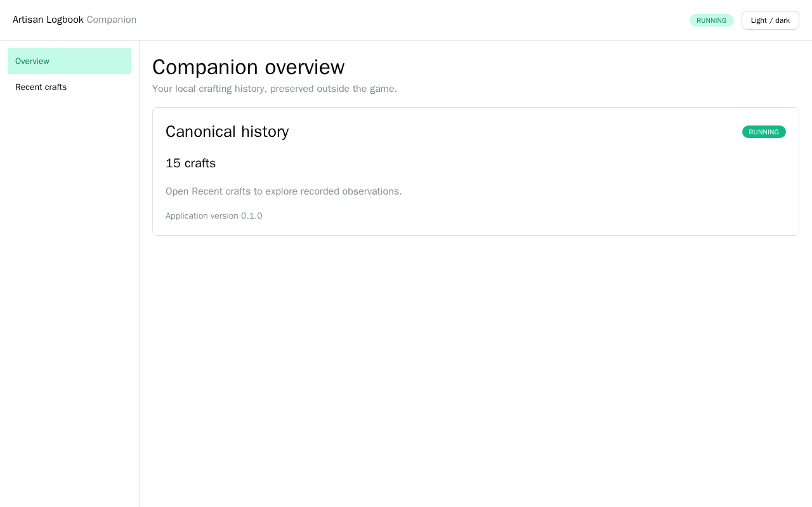
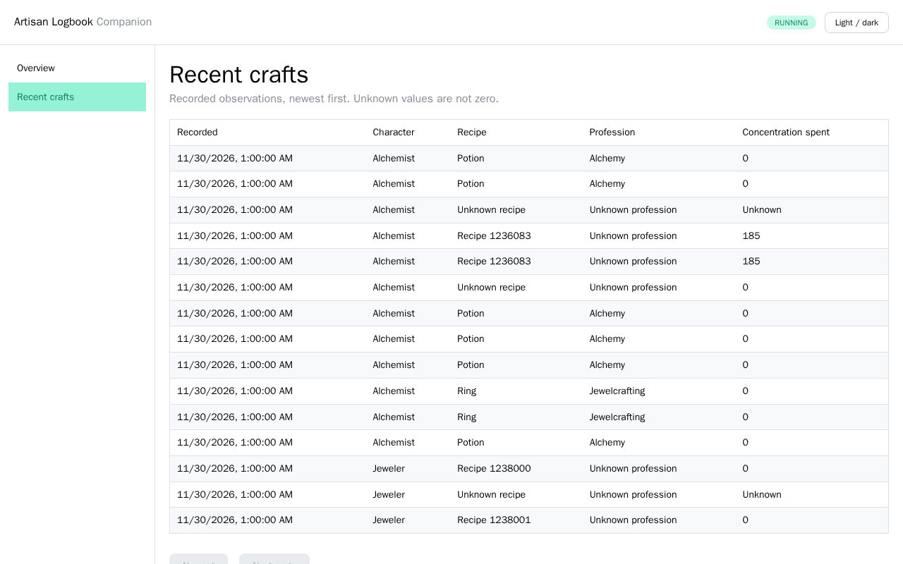

# Browser application foundation

The Companion's browser application is a client-side React SPA, not the complete
C12 dashboard. It provides an overview (operational REST status) and a bounded,
forward-paginated recent-crafts table (canonical GraphQL history). Missing
metadata has explicit identity/unknown fallbacks; unknown concentration is not
zero. No analytics, charting, advanced table framework or global state framework
is introduced.

The following screenshots use the generated SavedVariables fixture through the
published executable, not mocked application data:




## Production architecture

```text
AppHost (development only) -> Companion CLI + Vite
Cli -> Runtime -> WebAssets (embedded HTML, JS, CSS)
Browser -> /api/v1 (operations) and /graphql (canonical history)
```

Source lives in `src/companion/web`: `src/app`, `src/api`, `src/graphql`,
`src/components`, `src/pages` and `src/styles`. `tools/AppHost` is separate from
the production reference graph. There is no ServiceDefaults project, database
container, production Node process or Aspire deployment.

The WebAssets MSBuild targets run **npm ci -> offline codegen -> strict
TypeScript check -> Vite build**. The lockfile is committed; generated TypeScript
and Vite `dist` are ignored and regenerated during the build. An npm restore
stamp changes with the dependency manifests; npm's postinstall also records a
successful direct/Aspire restore so a subsequent MSBuild does not restore again.
The frontend target uses source and
contract timestamps plus a file-list stamp (so deletions are detected).
An unchanged build skips restore and bundling.

Resource inclusion happens in a target **before the embedded-provider manifest
input calculation and AssignTargetPaths**, after Vite has finished. The glob is
not evaluated before a clean checkout's first build. The package generates the
embedded manifest, and Runtime serves streams through
`ManifestEmbeddedFileProvider` and ASP.NET Core static-file middleware. Assets
are not extracted and the entire bundle is not loaded into memory.
Resource Link metadata uses native path separators so the manifest's `wwwroot`
directory is generated correctly on both Windows and Linux.

The authored OpenAPI YAML is also embedded in Runtime and streamed at its
existing `/openapi/v1.yaml` route with the existing `text/yaml` type.
MinimalOpenAPI 1.1.0's schema publisher reads a sidecar from AppContext.BaseDirectory;
the executable-only smoke exposed a 500 when that file was absent. Only document
publication is adapted; generated endpoints, DTOs and the OpenAPI contract are
unchanged. No extraction/extra distributed file is needed.

Normal builds and publishes include production assets. For Vite-only development,
set the MSBuild property/environment variable `CompanionWebDevelopment=true`.
That builds a deliberately empty development provider and skips npm/bundling.
**Publishing with that property is rejected**. `dotnet publish --no-build` is
also rejected, even with the property unset, because it could reuse a development
assembly or stale frontend resources. Publish normally to validate/rebuild/include
the production provider. Do not run separate
MSBuild/npm restore invocations concurrently against the same checkout: npm ci
replaces node_modules. Parallel project builds in one solution graph share the
single WebAssets project normally.

The existing `dotnet pack --no-build` tool-package workflow remains supported
after a normal production build. The pinned .NET SDK also routes tool packing
through publish targets; the publish guard distinguishes that SDK packing mode
from an executable publish rather than breaking the existing package pipeline.

Only GET/HEAD `/`, `/history` and `/history/` fall back to the document. The API,
GraphQL, OpenAPI, unknown routes and missing assets do not fall back. Add known
routes explicitly when adding browser pages. HTML and hashed assets currently
retain the host's `Cache-Control: no-store`; we deliberately do not weaken API
caching/security or add a caching subsystem. Content types and `nosniff` come
from the existing host/static-file infrastructure.

All production dependencies are bundled locally. Mantine uses system fonts.
There are no CDNs, remote fonts, icons, analytics, cookies or authentication
services. A stricter CSP is deferred: Mantine's runtime style properties require
a considered policy, not a blanket CSP that breaks components.

## Tooling and local development

Required: repository-pinned .NET SDK **10.0.401**, Node **26.13.1 LTS**, npm **11**,
and Aspire CLI **13.6.5**. Install Aspire using its
[official installation instructions](https://aspire.dev/get-started/install-cli/).
The AppHost SDK and integrations are pinned to 13.6.5. It uses the CLI bundle
for its dashboard and orchestration. No Docker or external database is required.

From `src/companion`:

```sh
aspire run
```

For the lean development build without a production bundle (POSIX):

```sh
CompanionWebDevelopment=true aspire run --apphost tools/AppHost/AppHost.csproj
```

PowerShell equivalent:

```powershell
$env:CompanionWebDevelopment = 'true'
aspire run --apphost tools/AppHost/AppHost.csproj
Remove-Item Env:CompanionWebDevelopment # before production publishing
```

The CLI prints the dashboard URL and access token. Open the `web` resource's
HTTP endpoint from that dashboard. Aspire allocates **unproxied** endpoints for
both processes, so no Aspire HTTP proxy changes browser Host/Origin semantics.
The Companion receives its allocated port through existing `--port` plus
`--require-port` (fail on a conflict, never silently use an undiscovered port).
It remains bound to 127.0.0.1. Vite uses its integration's existing endpoint
and PORT/port argument; no second endpoint is added. The committed
`aspire.config.json` selects `tools/AppHost/AppHost.csproj`; the explicit
`aspire run --apphost tools/AppHost/AppHost.csproj` form works too. `WaitFor` uses the actual
`/api/v1/health` HTTP health check before starting Vite. Vite supplies HMR.
Aspire enables Vite's supported 300 ms polling watcher for this small source tree,
so hot updates also work in devcontainers and mounted/network workspaces where
native file events can be absent. Direct Vite users can set `VITE_USE_POLLING=true`
in those environments.

`COMPANION_URL` is supplied to Vite from the Companion endpoint. Frontend code
always uses `/graphql` and `/api/v1`; the hostname/port are not compiled into JS.
Vite binds to 127.0.0.1, validates incoming loopback Host, exact Origin and
Sec-Fetch-Site before proxying, then rewrites **only validated** API Origins to
the upstream Companion origin. `changeOrigin` sets the upstream Host. Client
headers and bodies remain intact. Untrusted origins are rejected, not stripped.
CORS is disabled; backend security is never disabled.

The direct AppHost alternative after installing/initializing the Aspire CLI
bundle is:

```sh
dotnet run --project tools/AppHost/AppHost.csproj -p:CompanionWebDevelopment=true
```

For separate backend/frontend development:

```sh
ARTISAN_LOGBOOK_DATA_DIRECTORY="$(pwd)/.artifacts/development" \
dotnet run --project src/Cli/Cli.csproj -p:CompanionWebDevelopment=true -- \
  serve --monitoring false --port 48721 --require-port
# In another terminal, from src/companion/web:
COMPANION_URL=http://127.0.0.1:48721 npm run dev
```

Aspire normally uses random available ports. Optional `Development__CompanionPort`,
`Development__WebPort` and `Development__DataDirectory` settings are available
for reproducible smoke tests or explicit developer overrides.
`Development__InstallFrontend=false` skips Aspire's npm installer when dependencies
have already been restored. The smoke harness uses this after the production
build/npm restoration; ordinary AppHost startup defaults to reproducible npm ci.

### Isolated history and fixtures

Aspire defaults to `src/companion/.artifacts/development`. All default history,
settings and monitoring checkpoints live there. Logs go to process output and
the Aspire dashboard, not production log files. Monitoring is forcibly disabled
for this invocation; no real game installation is configured. The new
`ARTISAN_LOGBOOK_DATA_DIRECTORY` absolute-path override applies to **all CLI
commands**; a database-only override still has its original semantics.

Stop Aspire before offline import/reset because the existing writer owns the
database. Import through the existing canonical ingestion pipeline:

```sh
node tools/development.mjs import-fixture
aspire run --apphost tools/AppHost/AppHost.csproj
```

This imports the committed, generated `v1-outcome1.lua` SavedVariables fixture; repeated
imports are idempotent. It does not overwrite a populated database or seed through
repositories. For a larger history, stop Aspire and copy an existing database
to the development directory explicitly (never use the original path as the
development writer). Keep the matching monitoring sidecar if copying one.

Explicit reset, **after stopping Aspire**:

```sh
node tools/development.mjs reset --confirm
```

Only that one repository-owned development directory is removed. Reset first
probes the existing database using the CLI and refuses a busy/unopenable database.

### Frontend checks

From `src/companion/web` (not concurrently with an MSBuild frontend restore):

```sh
npm ci
npm run codegen
npm run typecheck
npm run lint
npm run format:check
npm run test
npm run build
npx playwright install chromium
npm run test:development
```

The final command starts the actual Aspire AppHost with temporary data, imports
through the CLI, verifies health/REST/GraphQL through Vite, rejects cross-origin
requests, runs a real Chromium navigation smoke and verifies a CSS hot update.
It restores the touched stylesheet and stops its helper processes. Playwright is
only a small smoke harness, not a second frontend testing framework or dashboard
end-to-end suite. Linux CI installs browser OS dependencies with `--with-deps`.

## Generated API contracts

Apollo Client 4 centralizes `/graphql`, POST-only transport, no credentials,
and `X-Artisan-Logbook-Client: web` in `src/api/clients.ts`. The complete REST
contract is generated with openapi-typescript and consumed by openapi-fetch;
it uses relative paths and the same header. Browser AbortSignals propagate to
REST. Problem responses preserve HTTP status/code, but the UI does not display
raw server exception details.

GraphQL Code Generator's client preset reads the committed
`src/Runtime/GraphQL/schema.graphql`, not live introspection. Operations are
`.graphql` source files; generated operation types/documents are the only
TypeScript representation. `npm run codegen` needs no running server. CI builds
against both committed contracts, while the existing backend SDL/OpenAPI
contract tests ensure they match the host.

Apollo's default `__typename:id` identity uses stable opaque canonical IDs.
Dimension IDs already include GameContext and entity kind; craft IDs encode the
canonical craft identity. No decoder or parallel cache identity is introduced.
Pagination uses `nodes`, `pageInfo.endCursor` and `hasNextPage` explicitly;
connections are not assumed to be full Relay connections. A page is replaced
when advancing, with a Newest action to reset; no generic pagination merger.

**Numeric policy:** standard JSON parsing is used. Generated Long/Decimal scalars
are `number`, matching runtime, but this is **not exact arbitrary-precision
preservation**. Do not use these mappings for precision-sensitive calculations.
The initial GraphQL operation only selects timestamps, strings and bounded Int
concentration; it does not request Long/Decimal observations or calculate
statistics. REST craft counts are shown only when `Number.isSafeInteger`, with
an explicit precision warning otherwise. Lossless quantity parsing/arithmetic
is deferred until a real C12 consumer needs it; the server scalar contract is
unchanged. Network/unavailable, HTTP rejection, GraphQL validation and execution
failures have redacted retry states; partial data can be shown with an error.

TypeScript stays on **5.9.3** because current openapi-typescript and
typescript-eslint peer ranges do not support TypeScript 7. The lockfile's
minimatch override uses patched 11.0.1 for current build tools' transitive glob
dependency; codegen/lint/tests verify compatibility. `npm audit` is clean.

## Publish and verify one executable

Supported distribution smoke targets are **linux-x64** and **win-x64**. From
`src/companion`, unset CompanionWebDevelopment, then:

```sh
dotnet publish src/Cli/Cli.csproj -c Release -r linux-x64 \
  --self-contained true -p:PublishSingleFile=true \
  -p:IncludeNativeLibrariesForSelfExtract=true -p:PublishTrimmed=false \
  -warnaserror -o .artifacts/publish/linux-x64
node tools/smoke-publish.mjs .artifacts/publish/linux-x64/artisanlogbook \
  ../addon/tests/fixtures/legacy/v1-outcome1.lua
```

PowerShell:

```powershell
dotnet publish src/Cli/Cli.csproj -c Release -r win-x64 --self-contained true `
  -p:PublishSingleFile=true -p:IncludeNativeLibrariesForSelfExtract=true `
  -p:PublishTrimmed=false -warnaserror -o .artifacts/publish/win-x64
node tools/smoke-publish.mjs .artifacts/publish/win-x64/artisanlogbook.exe `
  ../addon/tests/fixtures/legacy/v1-outcome1.lua
```

The smoke harness copies **only the executable** into a new empty temporary
directory, removes Node/npm/Aspire from the child's PATH, uses isolated writable
data, retrieves HTML and every referenced JS/CSS bundle with content-type checks,
opens `/history`, checks REST/OpenAPI/POST GraphQL and invalid routes/origins,
then runs Chromium against the application. It verifies empty history, stops,
imports the fixture with the copied executable, and repeats with populated
history. Linux shutdown must exit successfully; Node's Windows process signal
terminates the child rather than delivering console Ctrl+C, so this smoke does
not claim a Windows graceful-shutdown test. Existing backend lifecycle tests
remain authoritative there.

The browser harness is developer/CI tooling, not part of the distribution.
The application needs no Node, npm, Aspire, Docker, network, `wwwroot` or
separate frontend files. DuckDB native-library extraction and external writable
history/settings/checkpoints remain the existing single-file behavior.
The Windows local deployment script still publishes the CLI, not AppHost.
CI runs the full Companion tests, frontend checks, actual Aspire/HMR smoke and
executable-only/browser smoke on both Windows and Linux, and uploads screenshots.
